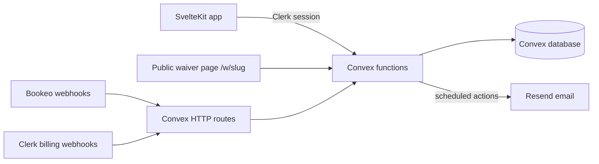

## Core invariants

Every change must preserve these:

- **Workspace isolation.** Every record belongs to one workspace, and every query and mutation is scoped to it.
- **Server-side authorization.** Convex functions check workspace membership and role on every call. The UI hiding a control is never the only protection.
- **Signed-record integrity.** Signed submissions are immutable. They reference a frozen published waiver version and store a booking snapshot taken at signing time.
- **Provider IDs are not authorization.** External identifiers from Bookeo or Mailchimp are integration and display values only.

## Request flow



- **Authentication**: Clerk issues the session. Convex validates the Clerk token and maps it to a Waiver Director user.
- **Authorization**: helpers in `src/convex/lib` resolve the user's membership in the requested workspace and check their role.
- **Billing**: Clerk billing webhooks update per-user entitlements, which gate features such as publishing, integrations, follow-ups, and analytics.

## Main data model

| Table                    | Holds                                                                           |
| ------------------------ | ------------------------------------------------------------------------------- |
| `workspaces`             | Workspace identity, handle, and status                                          |
| `workspace_memberships`  | User membership and role (`owner` or `staff`) per workspace                     |
| `workspace_waivers`      | The editable waiver draft and its public slug                                   |
| `waiver_versions`        | Frozen published versions                                                       |
| `waiver_submissions`     | Immutable signed submissions with answers and booking snapshot                  |
| `customers`              | Workspace-scoped signers, keyed by normalized email                             |
| `bookings`               | Provider bookings synced from Bookeo                                            |
| `participant_check_ins`  | Front-desk arrival marks per signed participant (not part of the signed record) |
| `submission_rosters`     | Small copy of who each signed submission covers, read by the check-in roster    |
| `kiosk_devices`          | Front-desk tablets allowed to use kiosk booking lookup (token hash only)        |
| `email_follow_ups`       | Follow-up emails and their delivery status                                      |
| `booking_integrations`   | Booking provider connections                                                    |
| `marketing_integrations` | Mailchimp connections                                                           |

See `src/convex/schema.ts` for the full schema.

## HTTP endpoints

| Path                     | Purpose                             |
| ------------------------ | ----------------------------------- |
| `/bookeo/callback`       | Bookeo authorization callback       |
| `/bookeo/webhook`        | Bookeo booking change notifications |
| `/mailchimp/callback`    | Mailchimp OAuth callback            |
| `/clerk/billing/webhook` | Clerk billing events                |

## Scheduled jobs

Daily cron jobs in `src/convex/crons.ts` prune expired connection sessions, old Bookeo webhook events, old marketing contact sync records, and stale kiosk lookup rate-limit counters.

## One-time backfills

The check-in roster reads `submission_rosters`, a small per-submission list of signer and minor names written at signing time. After deploying the check-in feature to a deployment that already has signed submissions, run this once to create rows for older submissions:

```sh
npx convex run checkIns:backfillSubmissionRosters '{}'
```

It is safe to run again; submissions that already have a row are skipped.

## Sample bookings for local testing

To try the kiosk and the **Check-in** page without a real Bookeo account, seed a few sample bookings into a development deployment. They are numbered `TEST-1001` to `TEST-1007` and placed around the current time: some today, one tomorrow, one later in the week, and one canceled.

```sh
npx convex run devSeed:seedTestBookings '{"workspaceSlug":"your-workspace"}'
npx convex run devSeed:clearTestBookings '{"workspaceSlug":"your-workspace"}'
```

Leave out `workspaceSlug` to seed every workspace in the deployment. Run the seed again to move the bookings relative to the current time. These are internal functions, so only someone with deploy access can run them.
