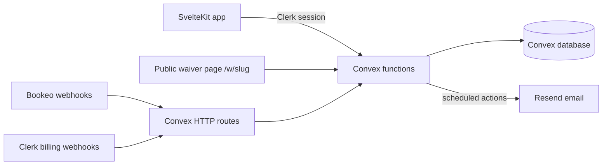

## Core invariants

Every change must preserve these:

- **Workspace isolation.** Every record belongs to one workspace, and every query and mutation is scoped to it.
- **Server-side authorization.** Convex functions check workspace membership and role on every call. The UI hiding a control is never the only protection.
- **Signed-record integrity.** Signed submissions are immutable. They reference a frozen published waiver version and store a booking snapshot taken at signing time.
- **Provider IDs are not authorization.** External identifiers from Bookeo or Mailchimp are integration and display values only.

## Request flow

- **Authentication**: Clerk issues the session. Convex validates the Clerk token and maps it to a Waiver Director user.
- **Authorization**: helpers in `src/convex/lib` resolve the user's membership in the requested workspace and check their role.
- **Billing**: Clerk billing webhooks update per-user entitlements, which gate features such as publishing, integrations, follow-ups, and analytics.

## Main data model

| Table                    | Holds                                                          |
| ------------------------ | -------------------------------------------------------------- |
| `workspaces`             | Workspace identity, handle, and status                         |
| `workspace_memberships`  | User membership and role (`owner` or `staff`) per workspace    |
| `workspace_waivers`      | The editable waiver draft and its public slug                  |
| `waiver_versions`        | Frozen published versions                                      |
| `waiver_submissions`     | Immutable signed submissions with answers and booking snapshot |
| `customers`              | Workspace-scoped signers, keyed by normalized email            |
| `bookings`               | Provider bookings synced from Bookeo                           |
| `email_follow_ups`       | Follow-up emails and their delivery status                     |
| `booking_integrations`   | Booking provider connections                                   |
| `marketing_integrations` | Mailchimp connections                                          |

See `src/convex/schema.ts` for the full schema.

## HTTP endpoints

| Path                     | Purpose                             |
| ------------------------ | ----------------------------------- |
| `/bookeo/callback`       | Bookeo authorization callback       |
| `/bookeo/webhook`        | Bookeo booking change notifications |
| `/mailchimp/callback`    | Mailchimp OAuth callback            |
| `/clerk/billing/webhook` | Clerk billing events                |

## Scheduled jobs

Daily cron jobs in `src/convex/crons.ts` prune expired connection sessions, old Bookeo webhook events, and old marketing contact sync records.
